<!-- Generated by Manas Soni Monolith Studio — Zero-Prose Visual Profile -->

  <a href="https://github.com/ManasSoni-2009">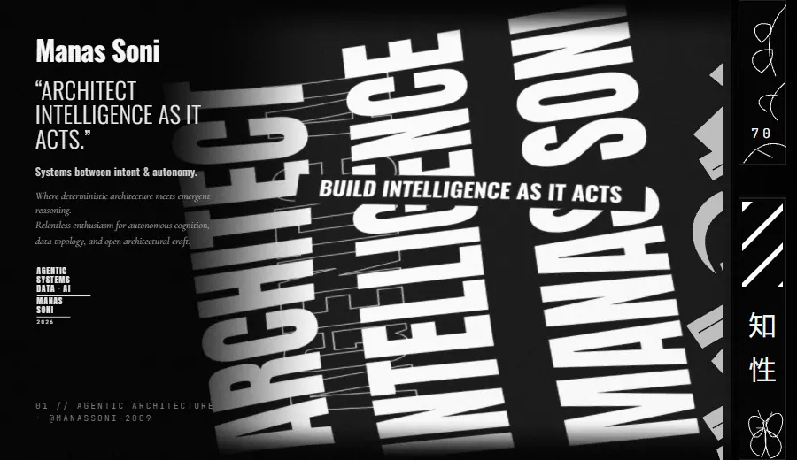</a> 
  <a href="https://github.com/ManasSoni-2009?tab=repositories">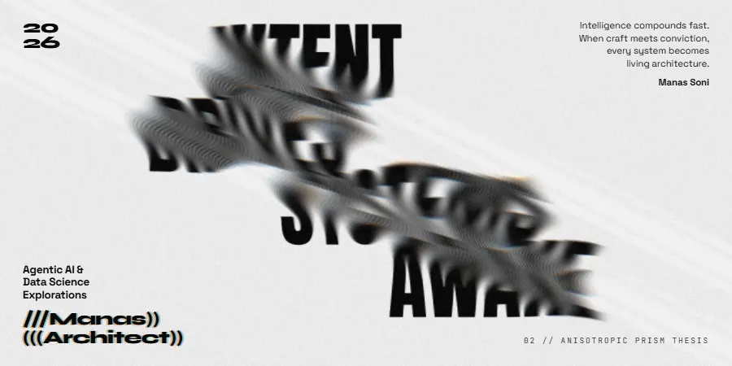</a> 
  <a href="https://github.com/ManasSoni-2009">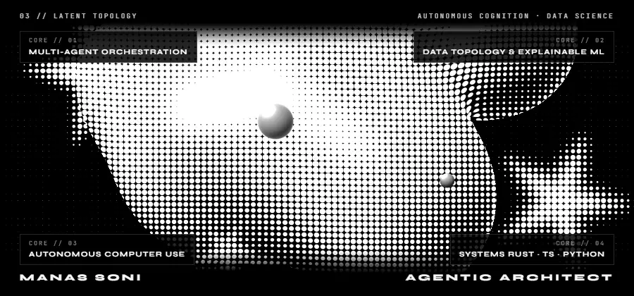</a> 
  <a href="https://github.com/ManasSoni-2009?tab=repositories">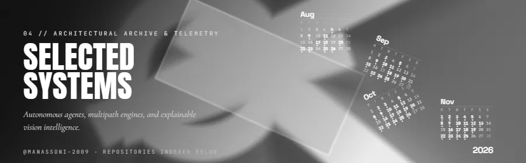</a> 
  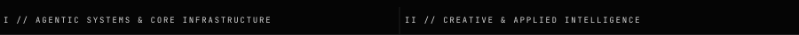 
  <a href="https://github.com/ManasSoni-2009/Project-JARVIS">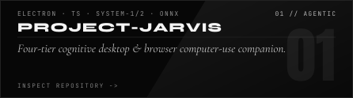</a><a href="https://github.com/ManasSoni-2009/GLYPH.DSGN">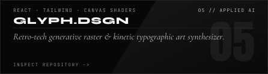</a> 
  <a href="https://github.com/ManasSoni-2009/void-gravity">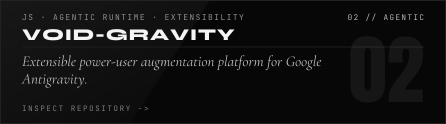</a><a href="https://github.com/ManasSoni-2009/OnionGrade">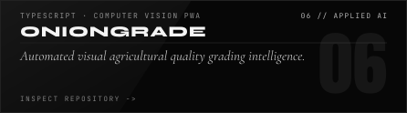</a> 
  <a href="https://github.com/ManasSoni-2009/Velocity">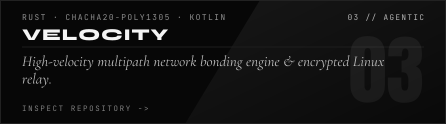</a><a href="https://github.com/ManasSoni-2009/MantraZ-Open-sourced-mantra-counter">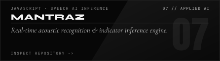</a> 
  <a href="https://github.com/ManasSoni-2009/retina-mitra">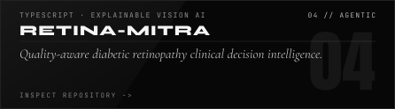</a><a href="https://github.com/ManasSoni-2009/Portfolio-Max">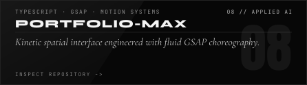</a> 
  <a href="https://github.com/ManasSoni-2009?tab=repositories">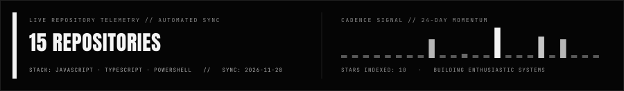</a> 
  <a href="mailto:manassoni009@gmail.com">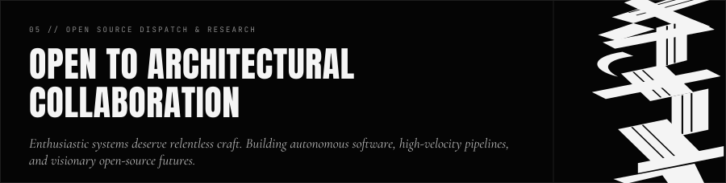</a> 
  <a href="https://github.com/ManasSoni-2009">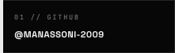</a><a href="mailto:manassoni009@gmail.com">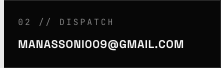</a><a href="https://www.linkedin.com/in/manas-soni-081573432">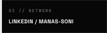</a><a href="https://www.instagram.com/lumino_ltr/">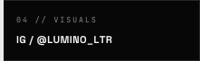</a>

